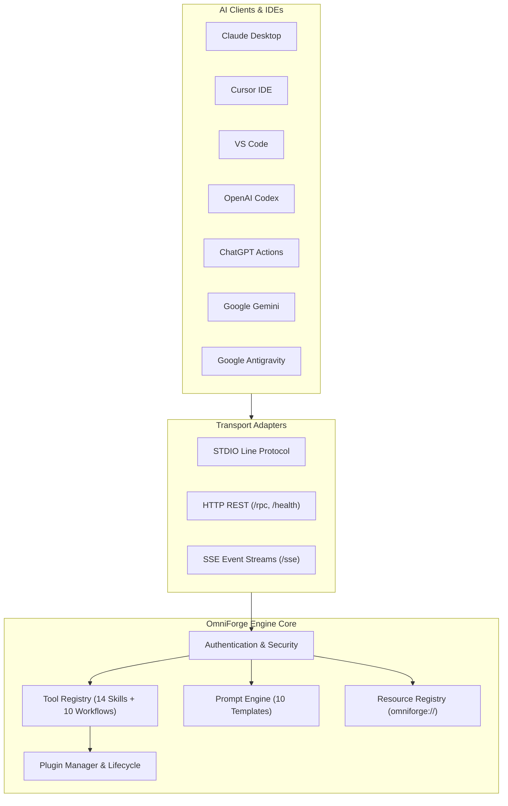

# OmniForge Architectural Design

**Author**: Ankur Gaurav  
**Architecture Style**: Hexagonal Architecture (Ports & Adapters)

---

## High-Level System Architecture

OmniForge MCP is structured around Hexagonal Architecture principles to decouple core domain logic (Skills, Prompts, Workflows) from external transport mechanisms (STDIO, HTTP REST, SSE) and AI Clients.

---

## Monorepo Package Communication

1. **`@omniforge/core`**: Supplies central Configuration, Telemetry, Logging, Plugin Loading, and Update Management across all entrypoints.
2. **`@omniforge/mcp-server`**: Implements JSON-RPC 2.0 protocol adapters over STDIO, HTTP, and SSE.
3. **`omniforge` (CLI)**: Command-line control suite for initializing projects, running diagnostic checks (`doctor`), executing workflows, and installing MCP integration into 7 AI clients.
4. **`@omniforge/sdk`**: Client libraries for TypeScript and Python.
