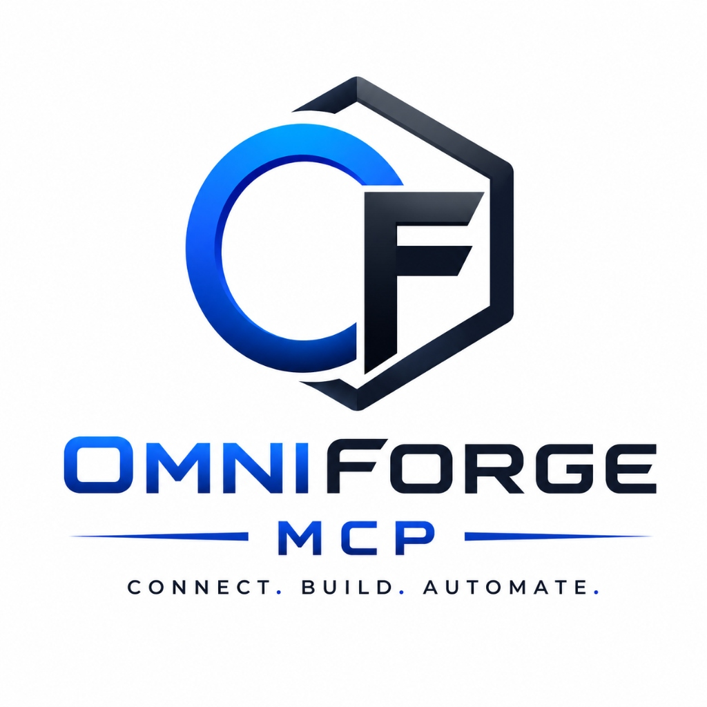
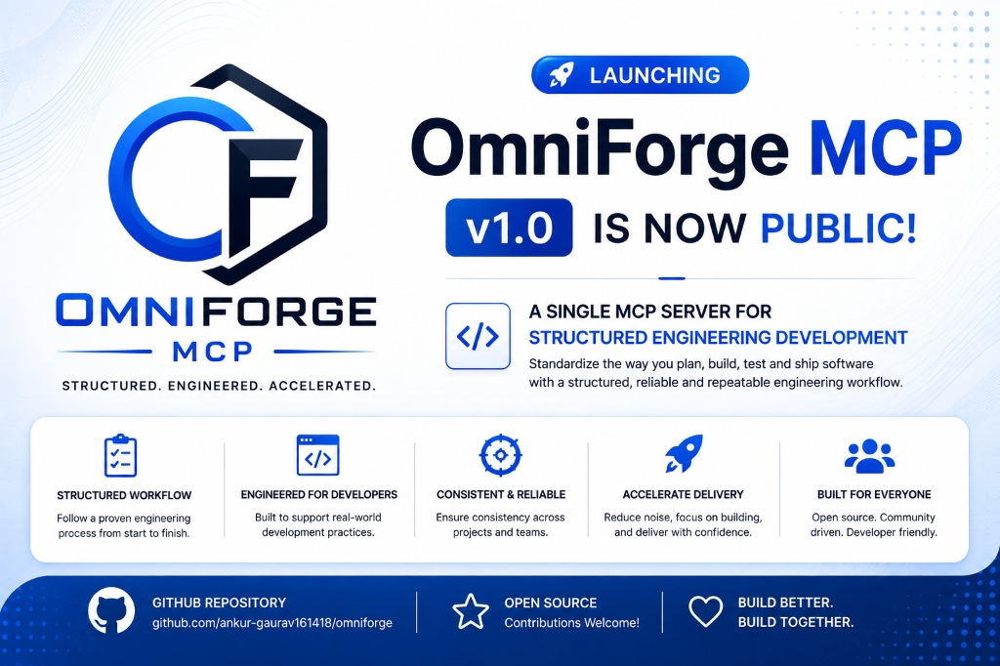
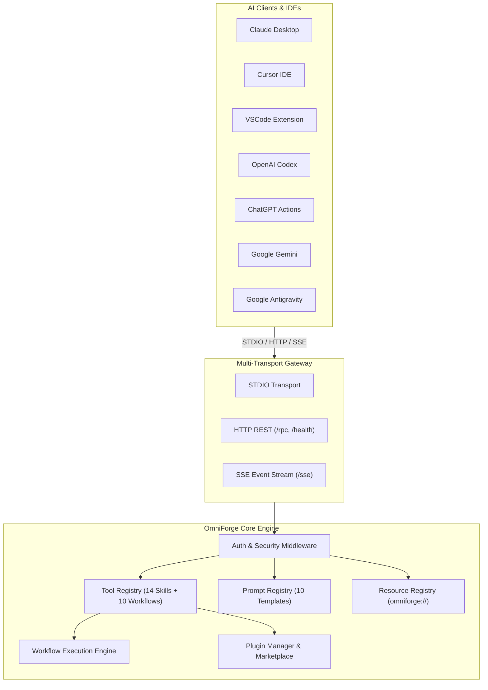

<p align="center">
  
</p>

<p align="center">
  
</p>

<h1 align="center">OmniForge MCP</h1>

<p align="center">
  <strong>Structured Engineering Development MCP Server for AI Coding Assistants</strong>
</p>

<p align="center">
  <a href="LICENSE"></a>
  <a href="https://github.com/ankur-gaurav161418/omniforge/stargazers"></a>
  <a href="https://github.com/ankur-gaurav161418/omniforge/network/members"></a>
  <a href="https://github.com/ankur-gaurav161418/omniforge/issues"></a>
  <a href="https://github.com/ankur-gaurav161418/omniforge/pulls"></a>
  <a href="https://github.com/ankur-gaurav161418/omniforge/releases"></a>
  <a href="https://github.com/ankur-gaurav161418"></a>
</p>

---

## 📌 Product Overview

**OmniForge MCP** is an enterprise-grade Model Context Protocol (MCP) platform created by **Ankur Gaurav** that enables AI coding assistants and autonomous agents to securely connect with external tools, APIs, databases, file systems, cloud services, and business applications through a unified, standardized interface.

The platform standardizes the way developer teams plan, build, test, and ship software by offering a structured, reliable, and repeatable engineering workflow.

---

## 🚀 Why OmniForge MCP?

Modern AI applications require reliable context and real-time execution capabilities. OmniForge MCP bridges the gap between Large Language Models (LLMs) and enterprise infrastructure by offering:

- **Structured Workflow**: Follow a proven software engineering process from start to finish.
- **Engineered for Developers**: Built to support real-world development practices and modern IDEs.
- **Consistent & Reliable**: Ensure consistency across projects, repositories, and developer teams.
- **Multi-Client Installation**: Single command `omniforge install --all` configures Claude Desktop, Cursor IDE, VS Code, OpenAI Codex, ChatGPT, Gemini, and Antigravity.
- **Accelerate Delivery**: Reduce noise, focus on building, and deliver with confidence.

---

## ✨ Features & Capabilities

| Feature | Status | Description |
|---|---|---|
| **STDIO Transport** | ✅ Production Ready | Standard I/O line protocol for desktop clients (Claude Desktop, Cursor, VSCode) |
| **HTTP & SSE Transports** | ✅ Production Ready | High-concurrency REST endpoints (`/rpc`, `/health`) and streaming event feeds (`/sse`) |
| **Tool Registry** | ✅ Production Ready | Exposes 14 agent skills and 10 engineering workflows as invokable MCP Tools |
| **Prompt Engine** | ✅ Production Ready | 10 enterprise prompt library templates with variable interpolation (`{{var}}`) |
| **Resource Registry** | ✅ Production Ready | Standardized `omniforge://` URI schemas for architecture docs and catalogs |
| **CLI Control Suite** | ✅ Production Ready | 12 operational subcommands (`init`, `doctor`, `install`, `search`, `workflow`, etc.) |
| **Multi-Client Installers** | ✅ Production Ready | Automated setup for Claude, Cursor, VS Code, Codex, ChatGPT, Gemini, and Antigravity |
| **Plugin Ecosystem** | ✅ Production Ready | Dynamic plugin manager with `git-enhancer` and `security-auditor` |
| **Authentication Middleware** | ✅ Production Ready | API Key and Bearer token security hooks for HTTP & SSE endpoints |
| **TypeScript & Python SDKs** | ✅ Production Ready | Strongly-typed client libraries for TypeScript and Python |

---

## 🏗️ Architecture Overview

OmniForge MCP follows Hexagonal Architecture principles, separating core business logic from external transports and integrations.



---

## 💻 Supported Clients

- **Claude Desktop** (Anthropic MCP Client)
- **Cursor IDE**
- **VS Code Extensions**
- **OpenAI Codex CLI**
- **ChatGPT Actions & Custom GPTs**
- **Google Gemini CLI**
- **Google Antigravity Agent**
- **LangChain & LlamaIndex Agents**
- **Custom Autonomous AI Agents**

---

## 📦 Installation

Install the OmniForge CLI globally via `npm`:

```bash
npm install -g omniforge
```

Or run via `npx`:

```bash
npx omniforge doctor
```

Install MCP integration into all supported AI clients:
```bash
omniforge install --all
```

---

## ⚡ Quick Start

### 1. System Diagnostic Health Check
Verify system environment, Node.js version, Git status, write permissions, and MCP server readiness:
```bash
omniforge doctor
```

### 2. Initialize Workspace
Generate `.omniforge/config.json` in your project directory:
```bash
omniforge init
```

### 3. Install AI Client Configurations
Auto-detect and generate MCP configuration files:
```bash
omniforge install --all
```

### 4. Start Production MCP Server
Start the server in HTTP/SSE mode (default port 8080):
```bash
npm run mcp:start
```

For STDIO mode (IDE integration):
```bash
node mcp/dist/server.js --stdio
```

---

## 📂 Folder Structure

```
omniforge/
├── apps/               # Modern Documentation & Interactive Dashboard App
├── packages/           # Monorepo Core & Client SDKs
│   ├── core/           # ConfigManager, Logger, Telemetry, PluginLoader, UpdateManager
│   └── sdk/            # TypeScript & Python Client SDKs
├── mcp/                # Production MCP Server (STDIO, HTTP, SSE)
│   ├── mcp.json        # MCP Manifest Descriptor
│   └── src/            # Transports, Handlers, Middleware
├── cli/                # OmniForge CLI Control Suite & Installers
├── skills/             # 14 Standardized & Categorized Agent Skills
├── prompts/            # 10 Enterprise Prompt Library Templates
├── workflows/          # 10 Executable Engineering Workflows
├── templates/          # Generator Templates (Project, Skill, Prompt, Plugin)
├── plugins/            # Dynamic Plugin System & Marketplace Architecture
├── docs/               # 16 Complete Documentation Guides & Tutorials
├── examples/           # Executable Demos & SDK Usage
├── tests/              # Vitest Test Suite (18 Test Files, 52 Tests)
├── sprints/            # 11 Sprint Deliverables Tracking (Sprint 1 to 11)
└── docker/             # Dockerfile & Docker Compose Configs
```

---

## 🗺️ Roadmap

All 11 development sprints have been fully completed:

| Sprint | Subfolder | Key Deliverables | Status |
|---|---|---|---|
| **Sprint 1** | [`sprints/sprint-1/`](sprints/sprint-1/README.md) | Monorepo Setup & Core Layout | ✅ Completed |
| **Sprint 2** | [`sprints/sprint-2/`](sprints/sprint-2/README.md) | Architecture & Error Hierarchy | ✅ Completed |
| **Sprint 3** | [`sprints/sprint-3/`](sprints/sprint-3/README.md) | Multi-Transport MCP Server (STDIO, HTTP, SSE) | ✅ Completed |
| **Sprint 4** | [`sprints/sprint-4/`](sprints/sprint-4/README.md) | 14 Agent Skills Migration & Validation | ✅ Completed |
| **Sprint 5** | [`sprints/sprint-5/`](sprints/sprint-5/README.md) | Enterprise Prompt Library & Prompt Engine | ✅ Completed |
| **Sprint 6** | [`sprints/sprint-6/`](sprints/sprint-6/README.md) | OmniForge CLI Suite & Master Rebranding | ✅ Completed |
| **Sprint 7** | [`sprints/sprint-7/`](sprints/sprint-7/README.md) | Plugin Loader Ecosystem & Marketplace Schema | ✅ Completed |
| **Sprint 8** | [`sprints/sprint-8/`](sprints/sprint-8/README.md) | Multi-Client MCP Installer Suite (7 AI Clients) | ✅ Completed |
| **Sprint 9** | [`sprints/sprint-9/`](sprints/sprint-9/README.md) | Complete 16 Documentation Guides & Portal | ✅ Completed |
| **Sprint 10** | [`sprints/sprint-10/`](sprints/sprint-10/README.md) | Performance, Regression & Coverage Test Suite | ✅ Completed |
| **Sprint 11** | [`sprints/sprint-11/`](sprints/sprint-11/README.md) | v1.0.0 Production Release & Public Launch | ✅ Completed |

---

## 🤝 Contributing

Contributions are welcome! Please read [CONTRIBUTING.md](docs/CONTRIBUTION.md) and [CODE_OF_CONDUCT.md](.github/CODE_OF_CONDUCT.md) before submitting pull requests.

```bash
git clone https://github.com/ankur-gaurav161418/omniforge.git
npm install
npm run build
npm test
```

---

## 📄 License

Distributed under the **MIT License**.  
Copyright (c) 2026 **Ankur Gaurav** ([https://github.com/ankur-gaurav161418](https://github.com/ankur-gaurav161418)).

---

## 💬 Support & Community

- **Repository**: [https://github.com/ankur-gaurav161418/omniforge](https://github.com/ankur-gaurav161418/omniforge)
- **Issues**: [Submit a Bug or Feature Request](https://github.com/ankur-gaurav161418/omniforge/issues)
- **Security Policy**: [SECURITY.md](.github/SECURITY.md)
- **Author**: **Ankur Gaurav** ([https://github.com/ankur-gaurav161418](https://github.com/ankur-gaurav161418))
