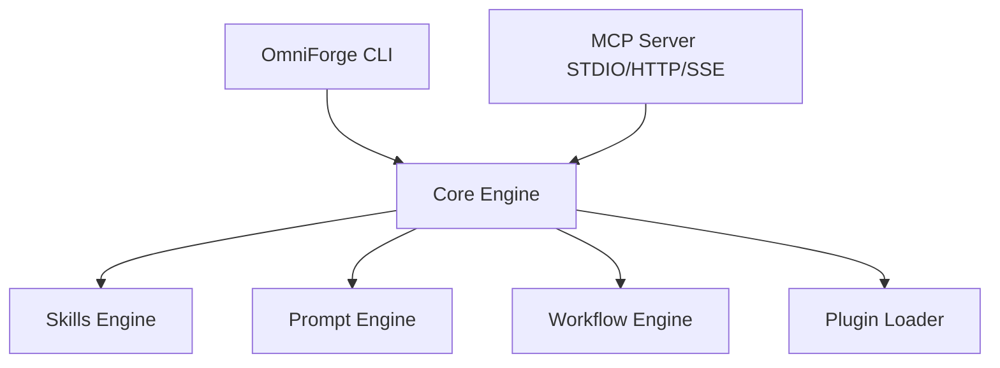

# OmniForge

```
  ______                   _ ______                                  
 / __   |                 (_|  ___/                                 
| |  |  | _ __  _ __  _    _| |__  ___  _ __  __ _  ___             
| |  |  || '_ \| '_ \| |  | |  __/ _ \| '__|/ _` |/ _ \            
| |__|  || | | | | | | |__| | | | (_) | |  | (_| |  __/            
 \______/|_| |_|_| |_|\____/|_|  \___/|_|   \__, |\___|            
                                             __/ |                  
                                            |___/                   
 Build • Orchestrate • Supercharge AI Engineering
```

[](LICENSE)
[]()
[](https://github.com/obra/superpowers)

> **Upstream Attribution**: OmniForge is an enterprise AI Engineering Framework derived from [superpowers](https://github.com/obra/superpowers) by Jesse Vincent (`obra/superpowers`). Original MIT Copyright (c) 2025 Jesse Vincent. See [NOTICE.md](NOTICE.md) for detailed attribution.

---

## Executive Summary

OmniForge is an enterprise-grade AI Engineering Framework that unifies AI Agent Skills, Prompt Engineering, Multi-Transport MCP Servers (STDIO, HTTP, SSE), and Engineering Workflows under a clean monorepo architecture.

## Architecture Overview



## Quick Start

### 1. Installation
```bash
npm install -g omniforge
```

### 2. System Diagnostic Check
```bash
omniforge doctor
```

### 3. Initialize Workspace
```bash
omniforge init
```

### 4. Start MCP Server
```bash
npm run mcp:start
```

## Subcommands Overview (17 Commands)

| Command | Description |
|---|---|
| `omniforge init` | Initialize `.omniforge/config.json` configuration |
| `omniforge install` | Install plugins and dependencies |
| `omniforge update` | Refresh skills and prompt catalogs |
| `omniforge upgrade` | Upgrade OmniForge runtime |
| `omniforge doctor` | Run diagnostic health check |
| `omniforge status` | View workspace status & MCP server details |
| `omniforge search` | Search skills, prompts, and workflows |
| `omniforge run` | Execute an autonomous agent task |
| `omniforge workflow` | Execute pre-packaged engineering workflows |
| `omniforge skill` | Manage skills catalog |
| `omniforge prompt` | Render and inspect prompt templates |
| `omniforge config` | Get or set configuration parameters |
| `omniforge version` | Print version metadata |
| `omniforge publish` | Publish packages to marketplace |
| `omniforge validate` | Validate skill and workflow schemas |
| `omniforge repair` | Repair workspace configuration |
| `omniforge uninstall` | Cleanly remove OmniForge |

## Core Skills Catalog (14 Upstream & Extended Skills)

1. `brainstorming`: Interactive design session
2. `systematic-debugging`: Root-cause defect isolation
3. `test-driven-development`: Red-Green-Refactor cycle
4. `subagent-driven-development`: Parallel subagent dispatch
5. `verification-before-completion`: Verification criteria enforcement
6. `executing-plans`: Implementation plan execution
7. `writing-plans`: Implementation plan drafting
8. `writing-skills`: Custom skill creation guide
9. `using-git-worktrees`: Isolated git worktree development
10. `dispatching-parallel-agents`: Multi-agent scheduling
11. `receiving-code-review`: Objective code review processing
12. `requesting-code-review`: Pull request preparation
13. `finishing-a-development-branch`: Branch merging & changelog update
14. `using-omniforge`: Primary framework guide

## License & Attribution

Distributed under the **MIT License**.
Original Upstream Work Copyright (c) 2025 Jesse Vincent (`obra/superpowers`).
OmniForge Distribution Copyright (c) 2026 OmniForge Contributors.
