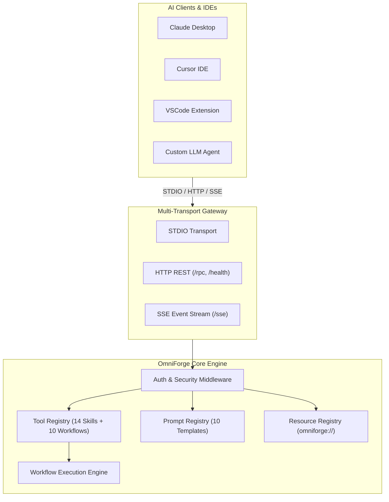

<p align="center">
  
</p>

<h1 align="center">OmniForge MCP</h1>

<p align="center">
  <strong>Connect • Build • Automate • Supercharge AI Engineering</strong>
</p>

<p align="center">
  <a href="LICENSE"></a>
  <a href="https://github.com/ankur-gaurav161418/omniforge/stargazers"></a>
  <a href="https://github.com/ankur-gaurav161418/omniforge/network/members"></a>
  <a href="https://github.com/ankur-gaurav161418/omniforge/issues"></a>
  <a href="https://github.com/ankur-gaurav161418/omniforge/pulls"></a>
  <a href="https://github.com/ankur-gaurav161418/omniforge/releases"></a>
  <a href="https://github.com/ankur-gaurav161418"></a>
</p>

---

## 📌 Product Overview

**OmniForge MCP** is an enterprise-grade Model Context Protocol (MCP) platform created by **Ankur Gaurav** that enables AI assistants and autonomous agents to securely connect with external tools, APIs, databases, file systems, cloud services, and business applications through a unified, standardized interface.

The platform provides a curated ecosystem of production-ready MCP servers, allowing developers to rapidly build, deploy, and orchestrate Agentic AI workflows without creating custom integrations for every application.

---

## 🚀 Why OmniForge MCP?

Modern AI applications require reliable context and real-time execution capabilities. OmniForge MCP bridges the gap between Large Language Models (LLMs) and enterprise infrastructure by offering:

- **Unified Connectivity**: Single interface for STDIO, HTTP, and Server-Sent Events (SSE) transports.
- **Enterprise Security**: Built-in Bearer Token and API Key authentication middleware.
- **Agentic Workflows**: Pre-packaged multi-step workflows for engineering, architecture, PRD drafting, testing, debugging, and deployment.
- **Production Readiness**: Health checks (`/health`), metrics (`/metrics`), zero-downtime hot-reloading, and schema validation.

---

## ✨ Features & Capabilities

| Feature | Status | Description |
|---|---|---|
| **STDIO Transport** | ✅ Production Ready | Standard I/O line protocol for desktop clients (Claude Desktop, Cursor, VSCode) |
| **HTTP & SSE Transports** | ✅ Production Ready | High-concurrency REST endpoints (`/rpc`, `/health`) and streaming event feeds (`/sse`) |
| **Tool Registry** | ✅ Production Ready | Exposes 14 agent skills and 10 engineering workflows as invokable MCP Tools |
| **Prompt Engine** | ✅ Production Ready | 10 enterprise prompt library templates with variable interpolation (`{{var}}`) |
| **Resource Registry** | ✅ Production Ready | Standardized `omniforge://` URI schemas for architecture docs and catalogs |
| **CLI Control Suite** | ✅ Production Ready | 12 operational subcommands (`init`, `doctor`, `install`, `search`, `workflow`, etc.) |
| **Authentication Middleware** | ✅ Production Ready | API Key and Bearer token security hooks for HTTP & SSE endpoints |
| **TypeScript & Python SDKs** | ✅ Production Ready | Strongly-typed client libraries for TypeScript and Python |

---

## 🏗️ Architecture Overview

OmniForge MCP follows Hexagonal Architecture principles, separating core business logic from external transports and integrations.



---

## 💻 Supported Platforms

- **Claude Desktop** (Anthropic MCP Client)
- **Cursor IDE**
- **VSCode Extensions**
- **LangChain & LlamaIndex Agents**
- **OpenAI Assistants SDK**
- **Custom Autonomous AI Agents**

---

## 📦 Installation

Install the OmniForge CLI globally via `npm`:

```bash
npm install -g omniforge
```

Or run via `npx`:

```bash
npx omniforge doctor
```

---

## ⚡ Quick Start

### 1. System Diagnostic Health Check
Verify system environment, Node.js version, Git status, write permissions, and MCP server readiness:
```bash
omniforge doctor
```

### 2. Initialize Workspace
Generate `.omniforge/config.json` in your project directory:
```bash
omniforge init
```

### 3. Start Production MCP Server
Start the server in HTTP/SSE mode (default port 8080):
```bash
npm run mcp:start
```

For STDIO mode (IDE integration):
```bash
node mcp/dist/server.js --stdio
```

---

## 📂 Repository Organization

```
omniforge/
├── apps/               # Modern Documentation & Interactive Dashboard App
├── packages/           # Monorepo Core & Client SDKs
│   ├── core/           # ConfigManager, Logger, Telemetry, PluginLoader
│   └── sdk/            # TypeScript & Python Client SDKs
├── mcp/                # Production MCP Server (STDIO, HTTP, SSE)
│   ├── mcp.json        # MCP Manifest Descriptor
│   └── src/            # Transports, Handlers, Middleware
├── cli/                # OmniForge CLI Control Suite
├── skills/             # 14 Standardized & Categorized Agent Skills
├── prompts/            # 10 Enterprise Prompt Library Templates
├── workflows/          # 10 Executable Engineering Workflows
├── templates/          # Generator Templates (Project, Skill, Prompt, Plugin)
├── plugins/            # Dynamic Plugin System & Extension Ecosystem
├── docs/               # Architecture Guides, API Reference, Tutorials
├── examples/           # Executable Demos & SDK Usage
├── tests/              # Vitest Test Suite (Unit, Integration, CLI, MCP)
├── sprints/            # Sprint Deliverables Tracking (Sprint 1 to 6)
└── docker/             # Dockerfile & Docker Compose Configs
```

---

## 🛠️ Example Usage

### Connecting via TypeScript SDK

```typescript
import { OmniForgeClient } from '@omniforge/sdk';

const client = new OmniForgeClient({ serverUrl: 'http://localhost:8080' });

// 1. Health Diagnostic Check
const health = await client.getHealth();
console.log('MCP Server Health:', health.status);

// 2. Execute Engineering Workflow
const result = await client.runWorkflow('engineering-workflow', {
  module: 'auth-service',
  env: 'staging'
});
console.log('Execution Result:', result);
```

### Connecting via Claude Desktop Config (`claude_desktop_config.json`)

```json
{
  "mcpServers": {
    "omniforge-mcp": {
      "command": "node",
      "args": ["d:/hackathon/omniforge/mcp/dist/server.js"]
    }
  }
}
```

---

## 🗺️ Roadmap

- [x] **Sprint 1**: Monorepo Foundation & Initial Architecture
- [x] **Sprint 2**: Modularity & Domain Error Hierarchy
- [x] **Sprint 3**: Multi-Transport Production MCP Server (STDIO, HTTP, SSE)
- [x] **Sprint 4**: 14 Agent Skills Migration & Schema Validation
- [x] **Sprint 5**: Enterprise Prompt Library & Prompt Engine
- [x] **Sprint 6**: OmniForge CLI Control Suite & Environment Validation
- [ ] **Sprint 7**: Hosted Plugin Marketplace & Web Dashboard

---

## 🤝 Contributing

Contributions are welcome! Please read [CONTRIBUTING.md](CONTRIBUTING.md) and [CODE_OF_CONDUCT.md](CODE_OF_CONDUCT.md) before submitting pull requests.

```bash
git clone https://github.com/ankur-gaurav161418/omniforge.git
npm install
npm run build
npm test
```

---

## 🔒 Security & Vulnerability Reporting

Security policy and vulnerability disclosure procedures are documented in [SECURITY.md](SECURITY.md).

---

## 📄 License

Distributed under the **MIT License**.  
Copyright (c) 2026 **Ankur Gaurav** ([https://github.com/ankur-gaurav161418](https://github.com/ankur-gaurav161418)).

---

## 🙏 Acknowledgements

Created and maintained by **Ankur Gaurav** for the global AI engineering community.
