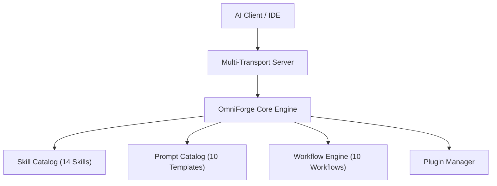

# OmniForge Architecture Guide

**Author**: Ankur Gaurav (https://github.com/ankur-gaurav161418)  
**License**: MIT License

---

## High-Level Architecture Overview

OmniForge MCP is designed around Clean Architecture and Hexagonal boundaries. The system decouples protocol adapters (STDIO, HTTP, SSE) from core domain services (Skill Engine, Prompt Engine, Workflow Runner, Plugin Loader).

## Core Packages

1. **`@omniforge/core`**: Base config, logger, telemetry, plugin loader, error hierarchy, update manager.
2. **`@omniforge/sdk`**: TypeScript & Python client SDKs.
3. **`@omniforge/mcp-server`**: Multi-transport MCP server (STDIO, HTTP, SSE).
4. **`@omniforge/skills`**: Skill Engine, validator, indexer, and catalog.
5. **`@omniforge/prompts`**: Prompt Engine, validator, indexer, and templates.
6. **`omniforge`**: Modular CLI binary (12 operational subcommands).
